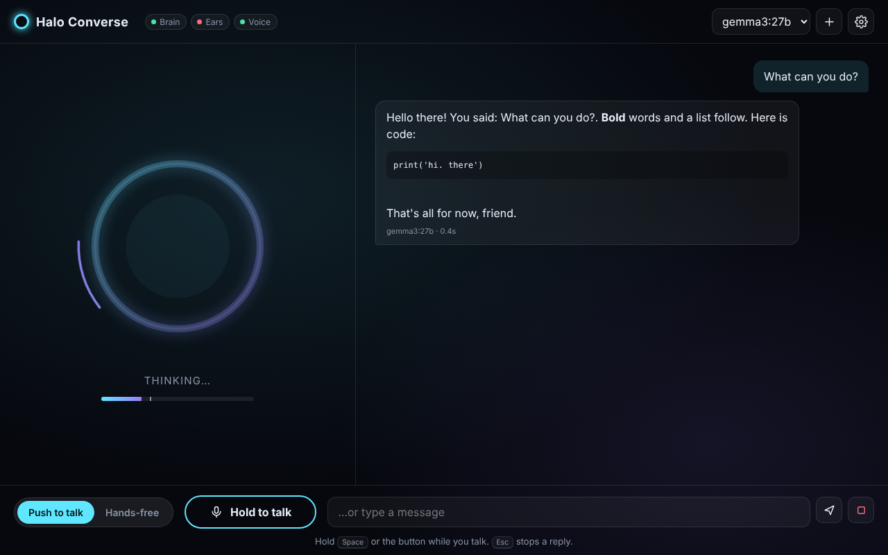

# Halo Converse

Offline voice chat for an AMD Ryzen AI Max+ 395 PC (Windows). Talk through a headset; a local AI listens, thinks and answers out loud. Nothing leaves the computer.

- **Ears:** Whisper (`small.en`, via faster-whisper)
- **Brain:** Ollama — `gemma3:27b` by default, `llama3.2:3b` for speed (or LM Studio)
- **Voice:** Piper (Lessac, Ryan, Cori, Alan)
- **Push to talk / Hands-free** toggle, talk-over-to-interrupt, headset picker, editable personality

## Use it from other devices on your network
Halo Converse also serves your home network over HTTPS (port 8443), so phones, tablets and other PCs can talk to it with their own mic.
The address is shown in the gear menu under **Use from other devices** (e.g. `https://192.168.1.50:8443`).
The first visit shows a certificate warning (Halo makes its own private certificate) — choose *Advanced → Continue*.
Each device keeps its own chat and settings; only the host PC can change the personality. Turn it off with `"share_on_network": false` in `config.json`.
If other devices can't connect, run **Allow on my network.bat** and make sure Windows has your network set to *Private*.

## Install (Windows)
1. Download this repo (Code → Download ZIP) and unzip somewhere permanent.
2. Double-click **Install Halo Converse.bat** (needs internet once; installs Python 3.12 and Ollama if missing, downloads voices and models).
3. Use the **Halo Converse** shortcut on your desktop.

## Use
- Hold **Space** (or the button) to talk, or switch to **Hands-free** and just talk.
- **Esc** stops a reply. The gear menu sets mic, voice, speed and sensitivity.

To use LM Studio instead of Ollama, set `"llm_backend": "openai"` in `config.json`.

See `README.txt` for troubleshooting.
